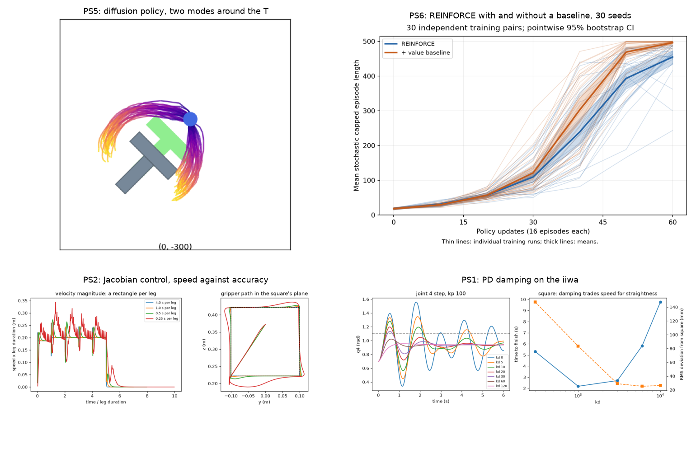

# Robotic Manipulation, from Perception to Grasp: MIT 6.4210/6.4212 Problem Sets



My solutions to all six problem sets of **MIT 6.4210/6.4212 Robotic Manipulation** (Fall 2026, Russ Tedrake and Tomas Lozano-Perez). I worked the graduate (6.4212) version: every bookwork question, every computational question, and the extra graduate problems. The code is Python with [Drake](https://drake.mit.edu), on a simulated KUKA iiwa with a Schunk WSG gripper. Every graded number in the answers is produced by a script in this repository, and the core functions are covered by a pytest suite that runs in GitHub Actions.

**This repository is private.** The course staff ask students not to publish homework solutions, and the course archive here includes official solutions. Please do not share it further.

## Summary

| Set | Topic | What I built | Headline result |
|---|---|---|---|
| [PS1](answers/ps1.md) | Getting started | Discrete-time systems in Drake, P, PD and waypoint control of a 2D Cartesian robot and the iiwa | iiwa traces a 0.4 m square in 2.7 s; studies of plant step, controller period and PD damping |
| [PS2](answers/ps2.md) | Transforms and kinematics | Planar FK, analytic IK and Jacobian; Jacobian pseudo-inverse control; a pick-and-place planner | iiwa stacks two blocks and stands the third on end, verified in **all 6 orders**; constant-speed timing that also accounts for rotation (0.0500 m/s measured, 0.05 requested) |
| [PS3](answers/ps3.md) | Optimization and motion planning | QPs; differential IK as a QP with velocity limits and a Cartesian wall; IK along a door-opening trajectory; PR2 mobile IK with collision constraints; RRT and RRT-Connect; exact edge checking | Door opened 79°; RRT-Connect solves 10/10 problems in under 0.2 s; with a certified edge checker, 0 of 5 paths fail the fine collision recheck |
| [PS4](answers/ps4.md) | Grasping | Depth-image normals by PCA; antipodal grasp sampling by ray casting with friction-cone filters; pick, turn and place of extruded letters; antipodal points on a curve by symbolic optimization | Turns my initial "P" to match "M" with **0.50°** final orientation error (0.03° for B to B) |
| [PS5](answers/ps5.md) | Behavior cloning | Mode analysis of the pretrained Push-T diffusion policy | Bimodal exactly at the symmetric start; a velocity in the observation history picks one mode |
| [PS6](answers/ps6.md) | Reinforcement learning | REINFORCE (with and without a value baseline) on Drake cart-pole; BC, GAE and clipped-PPO losses for residual RL on a pushing task | Baseline better by 39 steps (95% CI 23 to 58, p = 1.8·10⁻⁴); residual PPO cuts pushing time by 28% over BC, in all 10 independent training runs |

Each answer file has the Gradescope answers, the "going further" discussion, the computed checkpoints, and figures.

## Install and run

Python 3.13 and [uv](https://docs.astral.sh/uv/), as in the handouts README.

```
uv venv --python 3.13
uv pip install -r requirements.txt
source .venv/bin/activate
pytest -q tests                      # 56 tests, a few seconds
```

Each problem set's scripts run from its own directory, headless:

```
cd psets/ps1 && HEADLESS=1 python checkpoints.py && python extras.py
cd psets/ps2 && python checkpoints.py && python extras_64212.py
cd psets/ps4 && python run_letters.py P M --record
cd psets/ps5 && python action_modes.py          # downloads the authors' checkpoint (about 300 MB)
cd psets/ps6 && python run_analysis.py
```

For PS3, run each file's own `test1()` to `test6()` functions; their logs are in [`results/`](results). Meshcat replays of the iiwa square, the block stack and the letters are saved as standalone HTML in [`results/`](results); open them in a browser.

## Repository layout

| Path | Contents |
|---|---|
| `psets/ps1` to `psets/ps6` | My solutions: the handout code with every `NotImplementedError` filled in, plus my scripts for checkpoints, studies and figures |
| `answers/` | One write-up per problem set |
| `tests/` | pytest suite for the core functions, checked against hand calculations and analytic cases |
| `results/`, `psets/*/figures/`, `psets/ps6/results/` | Logs, tables, Meshcat replays and plots |
| `problem-sets-fall2026/` | The handouts exactly as released, kept unmodified for comparison (`diff -r problem-sets-fall2026 psets` shows my work) |
| `textbook/`, `lectures/`, `solutions/`, `project/`, `course-site/`, `older-offerings/` | Archived course materials, described in [`docs/ARCHIVE.md`](docs/ARCHIVE.md); sources in [`SOURCES.md`](SOURCES.md) |

## The course

**6.4210/6.4212 Robotic Manipulation** is MIT's course on building the software stack that lets a robot arm manipulate objects in clutter: kinematics, differential IK, optimization-based planning, sampling-based motion planning, grasping, perception, behavior cloning and reinforcement learning. It is taught by Russ Tedrake, who wrote the textbook and leads the development of Drake, and Tomas Lozano-Perez, whose work introduced configuration-space motion planning, both at MIT CSAIL. It follows Tedrake's open textbook [*Robotic Manipulation: Perception, Planning, and Control*](https://manipulation.csail.mit.edu) and uses his Drake toolbox throughout. 6.4212 is the graduate version, with extra problems in each set.

| Set | Main computational problems |
|---|---|
| PS1 | Body1D, P and PD controllers, feedback composition, waypoint follower; the 2D robot and the iiwa |
| PS2 | Planar FK/IK/Jacobian; overhead grasp; JointVelocity (pseudo-inverse); trajectory composition; stacking plan |
| PS3 | QP; DiffIK QP and the wall; door-opening IK; PR2 IK with restarts; RRT and RRT-Connect; exact edge checking (6.4212) |
| PS4 | Normal estimation; antipodal sampling and filtering; letter pick-and-place; analytic antipodal grasps (6.4212) |
| PS5 | Diffusion Policy on Push-T |
| PS6 | REINFORCE on cart-pole; residual PPO on a cautious pushing policy |

### Links

- Course site (Fall 2026): <https://manipulation.csail.mit.edu/Fall2026/>
- Textbook: <https://manipulation.csail.mit.edu>
- Textbook and `manipulation` package repository: <https://github.com/RussTedrake/manipulation>
- Russ Tedrake: <https://groups.csail.mit.edu/locomotion/russt.html>
- Tomas Lozano-Perez: <https://people.csail.mit.edu/tlp/>
- Drake: <https://drake.mit.edu>

## Validation

- **Hand calculations.** Every closed-form Gradescope value in the computational parts (forward Euler steps, Jacobian entries, QP solutions, PPO and GAE values) has a test that checks the code against the hand result.
- **Analytic cases.** IK round trips and finite-difference Jacobians on random configurations. Normals of a tilted plane. Antipodal pairs on a box mesh. Stationary pairs on an ellipse. The exact edge checker reproduces the sequence of evaluations worked out by hand for Problem 17.
- **Simulation outcomes.** The block stack is checked for every ordering of the three blocks, by measured final poses rather than by eye. The letter task reports the final orientation error. The diffusion policy's modes are counted from samples.
- **Independence of answers.** I committed every answer before opening the official solutions for PS1 to PS4 (PS5 and PS6 solutions are not posted). The comparison is in [`answers/comparison_with_official_solutions.md`](answers/comparison_with_official_solutions.md).
- **Compute.** Nothing here needed a GPU. The two cart-pole training runs took about 20 s each on a Mac Studio (M4 Max). The long PPO runs were supplied by the course and are analyzed, not repeated.

## What I learned

The thread through these six sets was learning to tell when a result was right, without an answer key. In PS1 that meant noticing that a P controller on a forward-Euler point mass does not settle, it gains energy, and that "come to rest" needs a tolerance before it means anything. In PS2 a stacking plan that worked in one order told me nothing about the other five, so I wrote the check that runs all six and measures the final poses. The 6.4212 problems were the most useful, because they ask why a method works rather than whether it does. Proving the exact edge-checking theorem and then using it on the iiwa showed me concretely why sampled collision checks can pass a path that collides (the planner's own path did), and why a uniform safety margin would have made the planner reject its own goal. In the learning sets I saw the same lesson from the other side. Reproducing the demonstrations exactly is not the same as doing the task well, which is why residual PPO could make a perfectly imitated but cautious pusher 28% faster. And the statistics only mean something when the unit of analysis is a training run, not an episode. These are the habits I expect to carry into research on robot hands and assistive devices, where contact, uncertainty and limited data come together.

## Credit

The problem sets, starter code, textbook, figures and data are by Russ Tedrake, Tomas Lozano-Perez and the 6.4210/6.4212 course staff at MIT (BSD 3-clause for the code; course pages, slides and solutions are copyright their authors). The Push-T demonstrations, network and pretrained checkpoint are from Chi et al., *Diffusion Policy: Visuomotor Policy Learning via Action Diffusion* (RSS 2023). The supplied residual-PPO training runs and the 30-pair cart-pole study are the course staff's. The code in `psets/` beyond the starter code, the scripts, the tests and the write-ups are mine. No other students' solutions were used.
