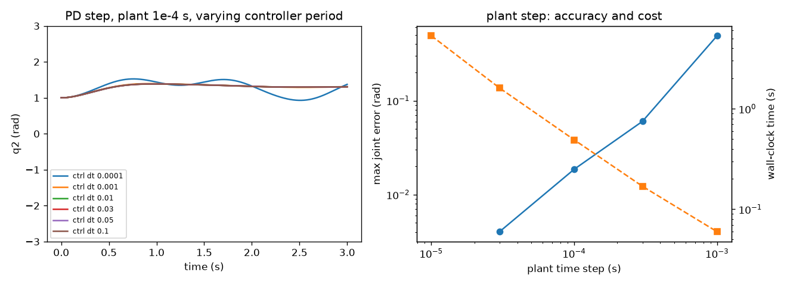
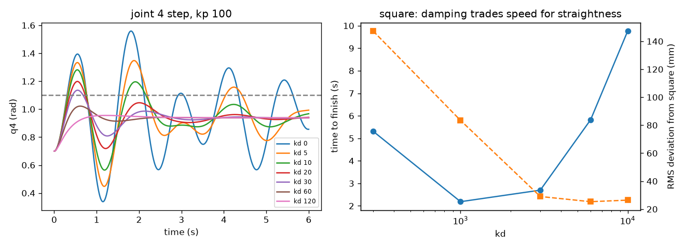

# Problem Set 1: Getting Started

Code: [`psets/ps1/`](../psets/ps1). Numbers below come from `HEADLESS=1 python checkpoints.py` and `python extras.py` in that directory.

## Bookwork

**Problem 1, state.**
- 1.1 Pendulum in the plane: **2** (angle and angular velocity).
- 1.2 Free body in 3D: **12** (position, orientation, linear and angular velocity).
- 1.3 Slow mobile robot with a battery: **4** (x, y, heading, charge). Velocity is ignored, but the charge carries information about the past that decides where it can go next.

Going further: on a cart, the state grows by 2 (cart position and velocity), to 4. With a spring rod it also grows by 2 (rod length and its rate), to 4.

**Problem 2, configuration and actuation.**
- 2.1 Differential drive: configuration **3** (x, y, θ), actuation **2** (one per wheel).
- 2.2 iiwa: **7** and **7**.
- 2.3 Quadrotor: **6** and **4**.

Going further: a snake has many joints but few actuated ways to move its body as a whole, so it relies on friction with the ground to locomote. The articulated bus has 4 configuration coordinates (x, y, heading and hinge angle) and 2 inputs (drive and steer).

**Problem 3.** **D**: manipulation changes the world through selective contact. Going further: a plow or a vacuum that nudges chairs is manipulating, even though it is built like a car.

**Problem 4.** **All four.**

**Problem 5, joints.** 5.1 **A** revolute. 5.2 **B** prismatic. 5.3 **B** prismatic. 5.4 **D** free. Going further: a screw is a helical joint with 1 DOF, because rotation and translation are coupled by the pitch. It can be modeled as a revolute plus a prismatic joint with a constraint between them. A shoulder is a ball joint with 3 DOF, which can be built from three revolute joints with intersecting axes.

**Problem 6, Drake.** Block diagrams, optimization toolkit, physics engine, and deterministic replay. GPU-parallel simulation is **not** one of them. Deterministic replay matters because a failure you can reproduce is a failure you can debug.

## Computational

| Part | Answer |
|---|---|
| 7.1 One forward-Euler step (m = 2 kg, dt = 0.1 s, x = 0, v = 0.5, F = 0.3 N) | x = **0.0500** m, v = **0.5150** m/s |
| 7.2 Five steps of 0.1 N from rest | x = **0.0050** m, v = **0.0250** m/s |
| 7.3 P controller force (set point 1, gain 10, x = 0.2) | **8.0** N |
| 7.4 P control of the 1D body, gain 10 | **C**: oscillates with growing amplitude. The error grows from 1.1 m in the first 2 s to 9.3 m in the last 2 s. Forward Euler on an undamped oscillator adds energy every step. |
| 8.1 Why the velocities plateau | **D**: joint damping balances the force. The final velocity is (0.40, 0.10) m/s = F / b exactly. |
| 8.2 Settling time to (0.9, 0.6), gain 100 | **about 1.7 s** (within 1 mm and 1 mm/s from 1.73 s; within 10 mm and 10 mm/s from 1.32 s) |
| 8.3 Path length around SQUARE (damping 20, gain 100, 5 s) | ε = 0.1: **2.1507** m; ε = 0.01: **2.3719** m |
| 9.1 Zero torque | **C**: it swings down like a multi-link pendulum |
| 9.2 20 N·m on every joint | **D**: the joints wind up against their limits (final q = [2.97, 2.09, 2.97, 1.72, 2.97, 2.09, 3.05], v = 0) |
| 9.3 P control, gain 100 | **C**: it oscillates around a gravity-sagged pose (q2 sags about 0.75 rad), with amplitude slowly decreasing |
| 9.4 PD step, kp 100, kd 30 | at rest after **about 4.0 s** (within 0.01 rad and 0.01 rad/s; 6.5 s for 0.001). It is at rest but sagged: q2 ends 0.62 rad short of the target. |
| 9.5 iiwa draws the square (kp 10⁴, kd 3·10³, ε 0.01) | completes in 2.7 s. The end effector bows up to 73 mm off the straight edges, because the waypoints are joint-space steps. Replay: [`results/ps1_square_iiwa.html`](../results/ps1_square_iiwa.html) |

Figures: [`psets/ps1/figures/`](../psets/ps1/figures).

### 6.4212 Problem 10: step sizes

The plant step and the controller period play different roles.

- **Plant step h** is the integration accuracy of the physics. Taking h = 10⁻⁵ s as ground truth for the PD step response (controller at 1 ms), the maximum joint error is 4·10⁻³ rad at h = 3·10⁻⁵ s, 1.9·10⁻² rad at 10⁻⁴ s, 6·10⁻² rad at 3·10⁻⁴ s and 0.49 rad at 10⁻³ s. The error grows roughly linearly in h, as expected for a first-order discrete scheme. Wall-clock time falls in proportion: 5.3 s at 10⁻⁵ s versus 0.06 s at 10⁻³ s for 3 simulated seconds.
- **Controller period** sets how stale the feedback is. For the soft gains of 9.4 (kp 100, kd 30), periods from 10⁻⁴ s to 0.1 s give nearly the same response (q2 settles at 1.30 to 1.37 rad), because the arm's own dynamics are much slower than 0.1 s. With the stiff gains of 9.5 (kp 10⁴, kd 3·10³) the same step behaves differently. A controller period equal to the plant step (10⁻⁴ s) never settles: after 3 s the joints still swing 0.28 rad peak to peak, 0.26 rad from the target. The derivative term divides one plant step's motion by the period, so it acts on the noisiest possible velocity estimate. Periods from 2·10⁻⁴ s to 0.02 s settle to within 3 mrad. At 0.05 s a small limit cycle remains (7 mrad peak to peak), and at 0.1 s it is 1.6 mrad.
- **How they relate:** the controller period should be a few plant steps or more, so that the finite difference sees real motion, and well below the closed-loop time constant. The plant step must resolve the fastest dynamics, which stiff gains make faster. Wall-clock time is set by the plant step.

### 6.4212 Problem 11: PD damping

Joint-4 step of 0.4 rad at kp = 100:

| kd | overshoot (rad) | 2% settling (s) |
|---|---|---|
| 0 | 0.70 | > 6 (sustained oscillation) |
| 10 | 0.31 | > 6 |
| 30 | 0.20 | 4.6 |
| 60 | 0.08 | 2.1 |
| 120 | 0.02 | 2.4 (overdamped, slower) |

The step response is under-damped up to kd of about 60, near critical around 60 to 80, and over-damped by 120. The exact numbers depend on the configuration, because the effective inertia of joint 4 depends on how far out the rest of the arm reaches, and gravity loading changes with the pose.

On the square (kp = 10⁴): kd = 300 rings badly (max 441 mm off the square). kd = 1000 finishes fastest (2.2 s, 193 mm max). kd = 3000 finishes in 2.7 s with 73 mm max. kd = 6000 to 10000 is no straighter (72 to 74 mm) but 2 to 3.6 times slower. More damping removes the overshoot at each corner. Past critical damping it only slows the approach, and the remaining deviation comes from interpolating in joint space.

## What the code is doing

- `DTVectorSystem`: the state is whatever the next-state function needs, and the output is a function of state (and of input, when declared). Body1D has state (x, v) and output x. PController and Observer are stateless, with output depending on input. The waypoint follower's state is the index of the current waypoint, and its output depends only on that state, which is what breaks the algebraic loop when it is wired around the plant.
- dt appears in the physics (Euler step) and in the PD controller (finite-difference velocity). It does not appear in the P controller, which is memoryless. For the follower, dt only sets how often it checks for arrival.
- Larger ε cuts corners and shortens the path (2.15 m at ε = 0.1 versus 2.37 m at 0.01). With low gain, a small ε makes the follower wait at each corner until the slow, sagging controller gets inside ε.
