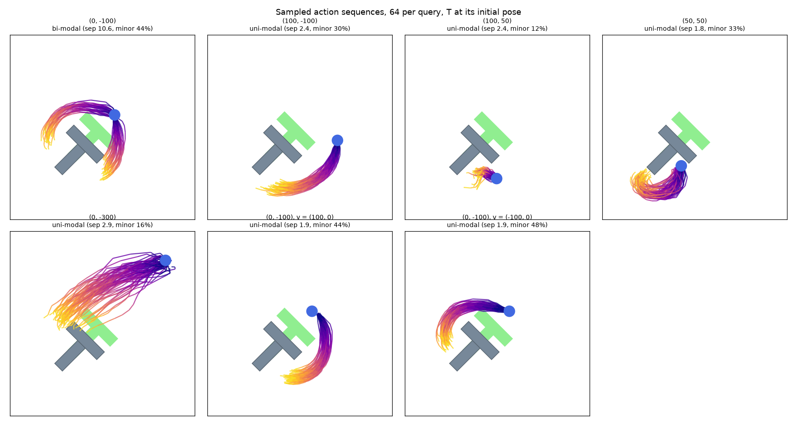
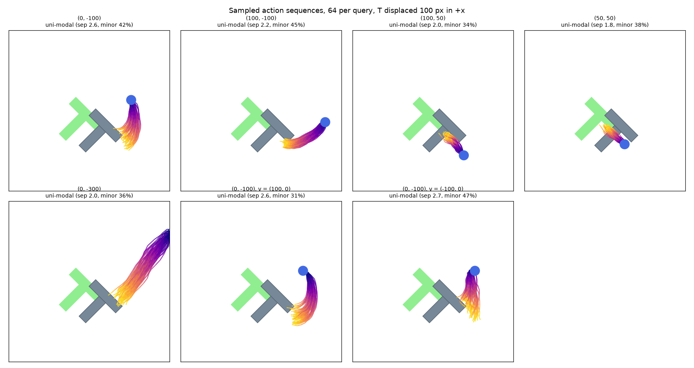

# Problem Set 5: Behavior Cloning

Code: [`psets/ps5/action_modes.py`](../psets/ps5/action_modes.py). Mode table: [`results/ps5_action_modes.md`](../results/ps5_action_modes.md).

## Bookwork

**Problem 1, discrete and continuous actions.**
- 1.1 k = Σyu / Σy² = 2.5 / 7.25 = **0.3448**.
- 1.2 **5**. Every rollout reaches x = 1 with |y| ≤ 0.345 < 0.75, inside the diamond.
- 1.3 [**0.5**, **0**, **0.5**].
- 1.4 [**0**, **1**].
- 1.5 [**0.20**, **0.66**, **1.00**] (tanh 0.2 = 0.197; tanh(0.197/0.25) = 0.658; tanh(0.658/0.0625) ≈ 1.000).

**Problem 2, pauses.**
- 2.1 **1/4**.
- 2.2 **2**: greedy picks "stay" at x = 2 forever.
- 2.3 **4** steps (a geometric distribution with p = 1/4).
- 2.4 (3/4)¹⁰ = **0.0563** (ten "stay" draws, at n = 2 to 11).
- 2.5 **h = 4**: the windows (0, 0, 1, 2), (0, 1, 2, 2), (1, 2, 2, 2) and (2, 2, 2, 2) are all distinct.
- 2.6 [**0**, **0**, **0.5**]: the chunks at x = 2 are (0, 0), (0, 0), (0, 1), (1, 1).

**Problem 3, the average of two good motions.**
- 3.1 â = (**0**, **0**); error **2**.
- 3.2 Success **1**; error **4** (0 or 8 with equal probability).
- 3.3 **0.5**.
- 3.4 **1**; **any p ∈ [0, 1]**; **no**.
- 3.5 p = **1/2**.

Going further: reproducing both routes matters when the route is chosen for a reason the observation does not show, such as a person standing on one side, or for robustness when one route is later blocked. Observing the demonstrator's intended route makes the problem unimodal given that input.

**Problem 4, DAgger.**
- 4.1 π_A **1**, π_B **2**; **π_A**.
- 4.2 Actions **F, L, F, F**; visited **S, C, R, R**; final **R**; expert labels **F, F, L, L**.
- 4.3 π_A **4**, π_B **3**; **π_B** is selected.
- 4.4 States **S, R, G**; **2** actions. Expert-only data from S: **no** (π_A is still chosen; S has 4 F labels against C's 3).

Going further: π_B goes through R, a state the expert never visits but from which L reaches the goal. Appending the learner's own actions as labels would teach the learner its own mistakes. Early iterations mix in expert actions (β > 0) so that rollouts stay near useful states while the policy is still poor.

**Problem 5, position or velocity.**
- 5.1 **100** mm/s; **200** mm/s.
- 5.2

| n | velocity command | position target |
|---|---|---|
| 1 | 0.500 | 0.500 |
| 2 | 1.000 | 0.750 |
| 3 | 1.500 | 0.875 |
| 10 | 5.000 | 0.999 |

  The **velocity-commanded** hand grows without bound.
- 5.3 Velocity: **4** mm; position: **0.5** mm (4, then 2, 1, 0.5).

Going further: yes, the velocity policy can correct the hand on its next observation, but until then the error persists. The position target corrects disturbances at the controller rate, while the policy is still thinking. Velocity commands recorded directly from the teleoperator avoid the differencing noise.

**Problem 6, frames.**
- 6.1 Absolute: A (**0.30**, **0.40**), B (**2.30**, **2.40**). Relative: (**0.10**, **0.20**) in both scenes.
- 6.2 Absolute: **no**; relative: **yes**.
- 6.3 **Yes**; ᵂX^{G_{t+j}} = **ᵂX^{G_t} · ^{G_t}X^{G_{t+j}}**.
- 6.4 Absolute range **[−9.95, 10.20]** m (span 20.15); relative **[0.05, 0.20]** m (span 0.15). A 0.01 scaled error is **201.5** mm absolute against **1.5** mm relative. **Absolute** needs a more accurate scaled prediction.

Going further: supplying the pose makes both representations expressible, but not equally easy to learn. The absolute mapping must reproduce h + d to millimeters over a 20 m range. The range argument is suggestive, not a proof. A network can predict the small relative displacement and let the controller compose it with the measured pose to get the world target.

**Problem 7, sharing demonstrations.**
- 7.1 **No**; **no**.
- 7.2 **Yes**; **no**.
- 7.3 w(A) = **3**, w(B) = **1**, w(C) = **0.2**; A's share of the batch weight is 6 / (6 + 3 + 1) = **0.6**.
- 7.4 Unweighted **0.28**; weighted **0.16**.

Going further: B and C reach different sets of hand poses, and follow different paths between them (their redundancy and limits differ), so some of their labels are infeasible or unnatural for A. Weighting changes emphasis but cannot make an infeasible target feasible.

**Problem 8, when to ask.**
- 8.1 o_A (**0.5**, **0**); o_B (**0.5**, **0.16**); o_C (**0**, **0**).
- 8.2 **o_B and o_C**; **o_C** would be missed by disagreement alone.

Going further: at o_A both models agree that the choice is a coin flip (real ambiguity), while at o_B they disagree (missing knowledge), so data helps more there. A unanimous ensemble can be confidently wrong far from the data (o_C). Neither U nor distance is a calibrated failure probability. Queried labels go back into the aggregated DAgger dataset.

**Problem 9, flow matching.**
- 9.1 Mean **t·x1**; variance **(1 − t)²**.
- 9.2 p_t(x) = ½ N(x; 2t, (1 − t)²) + ½ N(x; 4t, (1 − t)²).
- 9.3 By Bayes' rule with equal priors: f_t(x) = N(x; 2t, (1 − t)²) / [N(x; 2t, (1 − t)²) + N(x; 4t, (1 − t)²)]. With equal variances this is a logistic in x: f_t(x) = 1 / (1 + exp((2t x − 6t²)/(1 − t)²)).
- 9.4 **C**: at t = ½ it is 1 / (1 + e^{4x − 6}), decreasing through ½ at x = 1.5.
- 9.5 v_t(x) = f_t(x) (2 − x)/(1 − t) + (1 − f_t(x)) (4 − x)/(1 − t). Each endpoint's velocity is weighted by the posterior probability that this x is on its way to that endpoint.
- 9.6 At t = ½, v = 2(4 − x − 2f): **right, right, right, left** (v = 2.48, 3.52, 2.93 and −1.8·10⁻⁴).

Going further: as t → 1, f_t(x) → 1 for x < 3 and → 0 for x > 3, so v points to 2 or 4 respectively, and its magnitude |x1 − x|/(1 − t) blows up unless x is already at the endpoint.

**Problem 10, evidence.**

| N | Fisher exact p | significant? | z | approximate p | count check |
|---|---|---|---|---|---|
| 5 | **1.00** | no | **0.690** | **0.490** | fails (expected failures 1.5) |
| 10 | **0.628** | no | **0.976** | **0.329** | fails (3.0) |
| 100 | **0.00319** | yes | **3.09** | **0.00203** | passes |

- 10.3 **20** percentage points in all three. The first two do **not** establish p_A = p_B; they just lack the power to tell.

Going further: the same rates with more trials shrink the standard error by √N. Significance says nothing about whether 20 points matters for the application.

**Problem 11, rotations.**
- 11.1 RPY: **J, U**. Unit quaternion, both signs: **J, U, C**. Sign-fixed quaternion: **J, C**. All nine entries of R: **C**. Two columns of R: **C**.
- 11.2 r2 = u/‖u‖; w = v − (r2·v) r2; r3 = w/‖w‖; r1 = r2 × r3.
- 11.3 r1 = **(0, −1, 0)**; det R = **1**; with the cross product reversed, **−1**.

Going further: u = 0 or u parallel to v leaves the construction undefined. Different raw outputs map to the same rotation (any rescaling of u, any component of v along u), which is harmless for outputs. Discontinuity (J) matters for both inputs and outputs. The constraints (C) need a projection step when the representation is an output.

**Problem 12 (6.4212), diffusion.**
- 12.1 Mean **√ᾱ_t x0**; variance **1 − ᾱ_t**.
- 12.2 **No**: with ᾱ_T = 0.8 the signal still has 0.89 of its scale.
- 12.3 (i) **√ᾱ_t x0 + √(1 − ᾱ_t) z**; (ii) **√ᾱ_t x0**; (iii) **√(1 − ᾱ_t)**; (iv) **not present**; (v) **ε_θ(x_t, t)**.

Going further: σ_t = 0 gives a deterministic map from x_T. Samples still differ because x_T differs, but this stochastic-sampler schedule without noise no longer samples the right distribution (that needs DDIM's re-derived update). x̂0 = x_T − ε_θ forgets the scaling: x̂0 = (x_T − √(1 − ᾱ_T) ε_θ)/√ᾱ_T. Even scaled correctly, when ᾱ_T is tiny the single prediction is a posterior mean, so it gives a blurry average of the modes rather than a sample from one of them.

## Computational: Problem 13, diffusion policy on Push-T

The authors' pretrained checkpoint (Chi et al., RSS 2023), 64 samples per query.

Judged from the figures, and backed by a 2-means split of the sequence endpoints (bimodal when the gap between the cluster centers is more than four times the spread within them):

| T pose | pusher (T frame) | distribution | appropriate? |
|---|---|---|---|
| initial | (0, −100) | **bimodal**: around the left or the right of the top bar (separation 10.6) | yes: by symmetry both ways around are reasonable |
| initial | (100, −100) | unimodal: swings down and around to the stem's left side | yes |
| initial | (100, 50) | unimodal, short and hesitant | plausible: it is already near a pushing face |
| initial | (50, 50) | unimodal, loops down and back to push the stem | yes |
| initial | (0, −300) | unimodal and broad: comes back toward the T | yes, though spread out |
| initial | (0, −100), v = (100, 0) | unimodal, **right** branch | the motion in the history commits it to one side |
| initial | (0, −100), v = (−100, 0) | unimodal, **left** branch | same, mirrored |
| +100 px | (0, −100) | unimodal: down the right side to push the bar left | yes: the T must now move left toward the goal |
| +100 px | (100, −100) | unimodal: around to push the stem toward the goal | yes |
| +100 px | (100, 50) | unimodal: pushes the stem up and left | yes |
| +100 px | (50, 50) | unimodal: short push, up and left | yes |
| +100 px | (0, −300) | unimodal, approaches the bar's right end | yes |
| +100 px | (0, −100), v = (±100, 0) | unimodal, same as with no velocity | velocity no longer matters: the goal breaks the symmetry |

Takeaways: the policy is multimodal exactly where the demonstrations are, at the symmetric start above the T's bar. A velocity in the observation history selects one mode, which is how a short history (two observations) gives the policy commitment. Displacing the T removes the symmetry, and with it the second mode.
