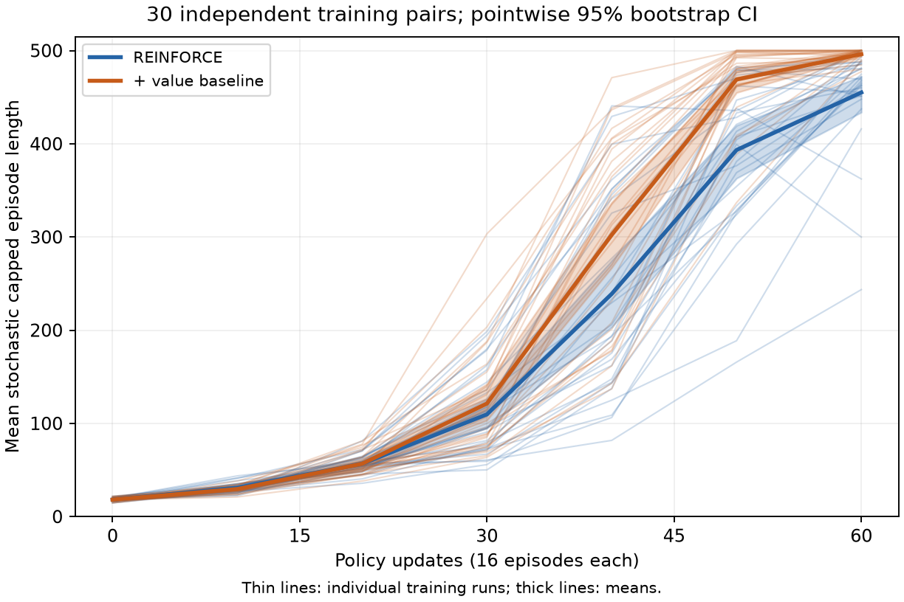

# Problem Set 6: Reinforcement Learning

Code: [`psets/ps6/reinforce.py`](../psets/ps6/reinforce.py), [`psets/ps6/push_math.py`](../psets/ps6/push_math.py). Numbers come from `python run_analysis.py` ([log](../results/ps6_analysis.log)). The local cart-pole pair was trained on the Mac Studio (about 20 s per run).

## Bookwork

**Problem 1, representations.**
- 1.1 Always A: **4** (0 + ½·4 + ¼·4 + ...); always B: **2**.
- 1.2 π*(L) = **A**, π*(H) = **A** (V(L) = 4, V(H) = 8).
- 1.3 Previous A: **4**; previous B: **0**.
- 1.4 r̄_A = **2**, r̄_B = **3**.
- 1.5 q_A = 2 + ½ max(q_A, q_B) and q_B = 3 + ½ max(q_A, q_B), so q_B = **6**, q_A = **5**; greedy picks **B**.

Going further: the optimal policy does not need to tell L from H (always A is optimal), but Q-learning's target assumes o is Markov. The benefit of A is that it moves the machine to H, so its reward shows up one step later, on whichever action comes next. With o alone, that delayed reward is credited to both actions equally. Including the previous action in the observation repairs it.

**Problem 2, all rewards positive.**
- 2.1 ∇ log p_L = (**0.5**, **−0.5**); ∇ log p_R = (**−0.5**, **0.5**).
- 2.2 L: (0.5, −0.5); R: (−1.5, 1.5). Both weights increase? **No**.
- 2.3 E[g] = (**−0.5**, **0.5**).
- 2.4 E[g] = (**−0.5**, **0.5**), unchanged.

Going further: the gradient of log p sums to zero over the logits (softmax is shift-invariant), so every update raises one logit and lowers the other. E[∇ log p] = 0, so adding a constant to the rewards adds c · E[∇ log p] = 0 in expectation, but each sampled update changes (by c ∇ log p_a), which is variance.

**Problem 3, Gaussian policy.**
- 3.1 ∂/∂μ = **(a − μ)/σ²**; ∂/∂σ = **−1/σ + (a − μ)²/σ³**.
- 3.2 a = −1: (g_μ, g_σ) = (**4**, **0**). a = 0: (**0**, **1**). a = 2: (**−2**, **−3**).
- 3.3 Moves the mean away: **C** (a = 2). Increases σ: **B** (a = 0).
- 3.4 μ = **−0.5**, σ = **0.25**.
- 3.5 J = **−[(μ − 1)² + σ²]**; J(0, 1) = **−2**; ∇J = (**2**, **−2**).
- 3.6 Advantage **1.75**. a = ½: g_σ = **−1.3125**, **decrease**. a = 3/2: g_σ = **2.1875**, **increase**. Boundary |a − μ| = **σ**.

Going further: J = −(μ − 1)² − σ² is maximized at σ = 0. A lucky far sample widens σ, but on average the gradient is −2σ.

**Problem 4, PPO.**
- 4.1 L(p) = 200p − 100, L′ = **200**; maximum at p = **1**.
- 4.2 p = **1.0**, ρ_R = **2**.
- 4.3 Flat from p = **0.6** (ρ_R = 1.2 and ρ_L = 0.8 together); L_clip(0.6) = **20**, L_clip(1) = **20**.
- 4.4 p: 0.54, 0.58, **0.62**; gradient there **0**.
- 4.5 **No**: at p = ½ the clipped objective has the same gradient (200), and one big step overshoots anyway. Clipping only removes the incentive once you are past the trust region. Several small steps would stop there.

Going further: with a lucky small batch, the estimated advantages are wrong, and a near-deterministic policy stops exploring and cannot correct them. Collecting new data before the policy commits is the point of on-policy iteration. Clipping guarantees nothing about the true return.

**Problem 5, randomness.** 5.1 **C**. 5.2 **B** (success 1/4; deterministic policies get 0). 5.3 **C**. 5.4 **D**. 5.5 **B**. 5.6 **D**.

## Computational

### Problem 6, cart-pole

| Part | Answer |
|---|---|
| 6.1 by hand | reward-to-go (**3**, **2**, **1**); loss −(−0.2·1 + −1.0·(−1) + −0.4·1)/2 = **−0.2**; a positive advantage **increases** the probability |
| random policy | the **pole** exceeds its angle limit after 34 steps (seed 200000) |
| local pair, seed 100 | mean return over 20 shared starts: plain **464.8**, baseline **490.2** (both reach 500 greedily; replays end at the 500-step horizon) |
| 6.2 by hand | n = **30**; df = **29** |
| 6.2 supplied study | D̄ = **39.10** steps; 95% bootstrap CI [**23.19**, **58.34**]; t = **4.290**; p = **1.81 × 10⁻⁴** |
| 6.2 bootstrap unit | **B** (both policies of one training seed) |
| 6.3 learning curves | [`psets/ps6/results/cartpole_reference/learning_uncertainty.png`](../psets/ps6/results/cartpole_reference/learning_uncertainty.png) |

Interpretation: at round 60, the baseline is significantly better (p = 1.8·10⁻⁴ < 0.05). The interval [23, 58] steps excludes zero, so the size and direction of the effect are both clear. It describes uncertainty in the mean difference, not the spread of episode returns. The thin lines show that some plain runs beat some baseline runs, so this is a statement about the average. The t-test assumes the 30 paired differences are independent and roughly normal (the 100 episodes per policy only define each policy's mean). With 30 pairs the t-test is fairly robust, and the bootstrap interval agrees with it. Without ẋ and θ̇ the state is not Markov and the policy cannot tell which way the pole is falling. γ = 1 is fine because episodes end within 500 steps.

### Problem 7, residual PPO on the cautious pusher

| Part | Answer |
|---|---|
| 7.1 | **A**; (0.30 − 0.015)/0.15 = **1.900**; **B** |
| 7.2 | g = **0.5**; correction **0**; ℓ(z = 0) = **0.0625** m; old joint log density ln(0.2 · 0.5) = **−2.303**; ratio **0.8**; **A** |
| 7.3 by hand | −(ln 0.8 + ln 0.5)/2 + (0.1² + 0.2²)/2 = 0.4581 + 0.0250 = **0.483** |
| 7.3 my BC fit | validation face accuracy **0.995**; distance MAE **0.128** cm; fit time **2.40** s; **A**; zero imitation error guarantees max reward? **no** |
| 7.4 | adv̂₀ = **0.770**; at a cutoff adv̂₀ = **1.245** and Ĝ₀ = **1.500**; **false** |
| 7.5 | actor loss **−0.200**; critic loss **2.500**; **false** (clipping removes the incentive to move further, but the optimizer can still push ratios outside [0.8, 1.2]) |
| 7.6 | initial θ **0.691**; updated θ **0.728**; optimizer steps **12** (approx. KL 0.0019, no early stop); **no** |
| 7.8 exploratory | mean time BC **87.92** s, residual at 4,096 pushes **71.58** s, at 8,192 **63.22** s; final success **1.000**; time saved **28.10%** |
| 7.8 confirmatory | n = **10**, df = **9**; mean reward gain **0.479**; 95% CI [**0.457**, **0.500**]; t = **41.817**; p = **1.28** × 10⁻¹¹; **A** |

All ten confirmatory runs beat BC (gains of 0.426 to 0.524 in mean return; exact sign test p = 0.002), finishing in 62 to 66 s with about 10 pushes instead of BC's 87 s and 14 pushes. The greedy policy is evaluated because it is the policy that would be deployed, and it removes sampling noise from the comparison. It is still reinforcement learning with one parameter: θ is chosen by trial, error and reward, not by imitation, and the critic and the advantages are learned.

### 6.4212 Problem 8: baselines

- 8.1 E[g_R,0] = **0.5**, Var = **1**.
- 8.2 g(L) = **0.5**, g(R) = **0.5**, Var = **0**.
- 8.3 E[g | b] = **½**; Var(g | b) = **(b − 2)²/4**; with m = 4, E[g] = **0.5** and Var(g) = E[(b − 2)²]/4 = 1/(4m) = **0.0625**.
- 8.4 g = **0**; **no** (its expectation is 0, not ½).
- 8.5 Var(g_μ,b) = (b + 4)² + 14: b = 0 gives **30**; b = −2 (the mean return) gives **18**; b = −4 gives **14**. The mean return is **not** always the lowest-variance baseline.

Going further: Var(g) = E[(r − b)² s²] − (E[r s])², and the derivative with respect to b is −2E[(r − b) s²] = 0, so b* = E[r s²]/E[s²]. For the Gaussian at (0, 1), s = a, so E[r a²] = −E[(a − 1)² a²] = −(E[a⁴] + E[a²]) = −4, and E[a²] = 1, giving b* = −4. b* equals the mean return when r is uncorrelated with s².
